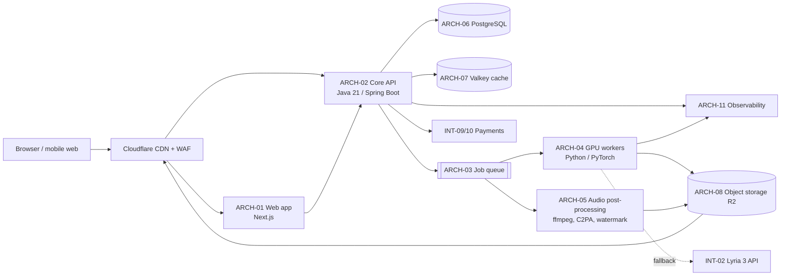
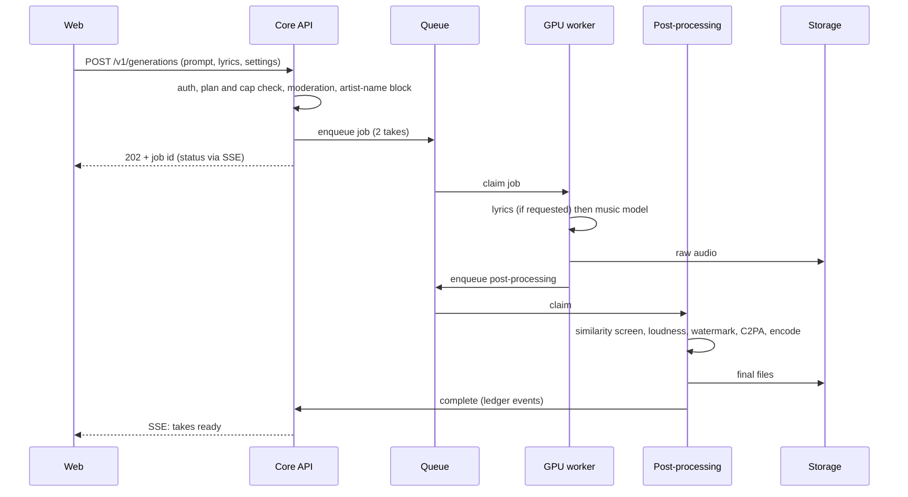

# BeatMind AI technical design document

| Item | Value |
| --- | --- |
| Version | 2.0 (supersedes v1.0 of 2026-10-22, SRC-003) |
| Date | 2026-10-28 |
| Owner | Engineering (3 senior developers); drafted by Claude as architect |
| Status | Draft for founder and developer review |
| Companion | [PRD v2.0](../02-product/prd.md); [ADRs](adr/) |
| Evidence tags | See [package README](../README.md#evidence-classification) |

## 1. Design goals and constraints

| Goal or constraint | Source | Design response |
| --- | --- | --- |
| Near-zero running cost before funding | DEC-004, DEC-014, A-002 | Open-weight models on rented or credited GPUs that scale to zero; free tiers for web, database, storage and CDN (ADR-006) |
| Scale to millions of users without redesign; hard to take down | DEC-011 | Stateless API replicas, queue-based GPU workers, CDN for all audio, managed Postgres with replicas later (section 9) |
| Three developers | DEC-006 | Modular monolith plus one worker type; few languages; managed services where free (ADR-001) |
| Java preferred, not required | DEC-011 | Java 21 and Spring Boot for the core; Python only where models require it (ADR-002) |
| No training data | DEC-005 | No foundation-model training in Phase 1 (ADR-007) |
| Users own paid songs; AI labelling required | DEC-009, SRC-117, SRC-119 | Rights and provenance are first-class modules (section 6) |
| India first | DEC-101 | Indian cloud region where available; UPI payments; Hindi text pipeline (Unicode, Devanagari) |

Nothing in this document is built yet (DEC-001).

## 2. Architecture overview

### 2.1 Components

| ID | Component | Technology | Responsibility |
| --- | --- | --- | --- |
| ARCH-01 | Web app | Next.js (React, TypeScript), next-intl for i18n, PWA | Pages, player, editor, checkout, admin console UI; server-side rendering for public song pages |
| ARCH-02 | Core API | Java 21, Spring Boot 3, Spring Security, Spring Data JPA, Flyway | Modular monolith with modules: identity, library, generation orchestration, rights and certificates, provenance, billing and pricing, moderation, admin |
| ARCH-03 | Job queue | PostgreSQL table with `FOR UPDATE SKIP LOCKED`, behind a `JobQueue` interface | Durable hand-off from API to workers; retries, priorities, dead-letter. Swap to RabbitMQ or Kafka when throughput needs it (ADR-005) |
| ARCH-04 | GPU workers | Python 3.11, PyTorch, model runners | Song and beat generation, lyric generation, stem separation |
| ARCH-05 | Post-processing workers | Python or Java on CPU; ffmpeg; c2pa-rs; AudioSeal | Loudness normalisation, encoding, watermark embed, C2PA manifest signing, fingerprinting |
| ARCH-06 | Primary database | PostgreSQL 16 | All transactional data, provenance ledger, queue |
| ARCH-07 | Cache | Valkey (open-source Redis fork) | Rate limits, sessions, hot reads |
| ARCH-08 | Object storage | Cloudflare R2 (S3 API) | Audio, stems, certificates; signed URLs |
| ARCH-09 | Edge | Cloudflare CDN, WAF, Turnstile (bot check) | Caching, DDoS protection, bot defence |
| ARCH-10 | Identity | Spring Security; Google OpenID Connect; email one-time code; phone OTP later | Sign-in, sessions (ADR-008) |
| ARCH-11 | Observability | OpenTelemetry; Prometheus, Loki, Tempo, Grafana (self-hosted or free cloud tier); Sentry-compatible error tracking (GlitchTip) | Metrics, logs, traces, alerts |
| ARCH-12 | Admin console | Part of ARCH-01 and ARCH-02, role-gated | Users, plans, moderation queue, takedowns, caps |
| ARCH-13 | Analytics | PostHog (open source) | Product analytics with consent |

### 2.2 Why this shape

A modular monolith keeps one deployable Java service for three developers while module boundaries (enforced with ArchUnit tests) allow later extraction into services. GPU work is the only part with different scaling and runtime needs, so it is the only separate service. Details in ADR-001.

## 3. Generation pipeline

Steps and rules:

1. **Admission (ARCH-02):** check plan, daily cap (REQ-F-55), moderation of prompt and lyrics (REQ-F-50, REQ-F-51), language gate status (REQ-F-07).
2. **Lyrics (optional):** open-weight language model writes sectioned lyrics (INT-04).
3. **Music:** primary model ACE-Step 1.5 generates two takes (INT-01). If the GPU pool is saturated or the language is routed to fallback, the Lyria 3 API is used (INT-02) within a daily spend cap.
4. **Similarity screen:** fingerprint the output and compare against the reference index; withhold close matches (REQ-F-52).
5. **Finishing:** loudness normalisation, watermark (INT-06), C2PA manifest (INT-07), MP3 preview, WAV master.
6. **Stems on request:** Demucs separation into 4 stems for paid users (INT-05).
7. **Ledger:** every step writes a provenance event (section 6).

## 4. Model strategy

Full decision in ADR-007. Licence facts must be confirmed by reading each licence file directly (C-02).

| Model | Role | Licence | Training data statement | Decision |
| --- | --- | --- | --- | --- |
| ACE-Step 1.5 | Primary song, vocal and beat generation; editing (repaint, extend) | MIT per model card [SS, SRC-106]; listed as Apache-2.0 by a secondary source [ES, SRC-107]. Both permissive. Outputs usable commercially per model card [SS] | "Licensed tracks, royalty-free and public-domain music, and synthetic audio" [SS, SRC-106] | **Primary** |
| HeartMuLa-oss-3B | Alternative song generator | Apache-2.0 for code and weights since 2026-01-20 [SS, SRC-105] | None published [SS, SRC-105] | Evaluate only (higher data risk) |
| YuE | Alternative lyrics-to-song | Apache-2.0 [ES, SRC-104] | Not stated [ES, SRC-104] | Evaluate only |
| Stable Audio 3.0 Small or Medium | Instrumentals, loops, sound effects | Stability Community Licence: free below US$1M annual revenue [ES, SRC-108] | "Trained entirely on licensed data" [ES, SRC-108] | Candidate for beat mode; vocals not confirmed |
| Google Lyria 3 Pro API | Paid fallback; Hindi quality backstop | Commercial API; terms to check (A-027) | Google's | Fallback with daily spend cap |
| MusicGen | | Weights CC-BY-NC [A, from prior research SRC-001] | | **Excluded**: non-commercial |
| LeVo / SongGeneration | | Tencent licence limited to academic, research and education use [ES, SRC-104] | | **Excluded**: non-commercial |
| Demucs | Stem separation | MIT [A, to confirm C-02] | | Selected |
| Basic Pitch | Melody to MIDI (Phase 2) | Apache-2.0 [A, to confirm C-02] | | Phase 2 |
| AudioSeal | Inaudible watermark | MIT [A, to confirm C-02] | | Selected |
| Lyric language model | Lyrics in Hindi, Hinglish, English | Candidate: an Apache-2.0 open-weight model such as the Qwen family [A, to confirm C-02] | Varies | Chosen in Sprint 1 after a Hindi lyric test |

**Model quality gate G1** (PRD section 12) decides which languages launch. The benchmark set, listener panel and scoring sheet are part of the validation plan (Batch 3).

## 5. Data model

### 5.1 Core entities

| Entity | Key fields | Notes |
| --- | --- | --- |
| `user` | id, email, phone (optional), country_signup, birth_year, locale, created_at | Personal data; DPDP and GDPR rules apply |
| `consent` | user_id, purpose (terms, privacy, marketing, training_opt_in, analytics), version, granted_at, withdrawn_at | Evidence for DPDP and GDPR consent |
| `subscription` | user_id, plan, billing_country, price_band, provider, status, period_end | Billing country decides price (REQ-F-41) |
| `credit_ledger` | user_id, delta, reason, job_id, balance_after | Append-only |
| `project` | id, owner_id, name | |
| `song` | id, project_id, owner_id, title, language, plan_at_creation, rights_status (bm_owned, free_licensed, user_owned), visibility | `plan_at_creation` fixes rights (REQ-F-25) |
| `take` | id, song_id, parent_take_id, model, model_version, seed, settings_json, status | Every edit is a new take |
| `asset` | id, take_id, kind (mp3, wav, stem_vocals, ..., certificate_pdf), storage_key, sha256, bytes | Files in R2 |
| `generation_job` | id, user_id, type, priority, status, attempts, cost_estimate, cost_actual, provider (self, lyria) | Also used as the queue table (ADR-005) |
| `provenance_event` | id, song_id, seq, type, actor (human, ai, system), payload_json, prev_hash, hash, created_at | Hash-chained, append-only (section 6) |
| `certificate` | id (public), song_id, licensee_user_id, scope (commercial_free, ownership_paid), issued_at, revoked_at | Shown on the verify page |
| `moderation_case`, `takedown_request` | target, reason, status, deadlines | Deadlines include 3 hours for Indian orders (REQ-F-54) |
| `price_band`, `country_price` | band factor; country, currency, plan, local price, valid_from | Reviewed quarterly |

### 5.2 Storage and retention

| Data | Store | Retention rule (to confirm in DPIA, Batch 2) |
| --- | --- | --- |
| Account data | PostgreSQL | Life of account, then deletion within 30 days unless law requires longer |
| Songs and files | R2 | Life of account; deleted songs purged after 30 days |
| Provenance ledger | PostgreSQL, monthly partitions | Kept for the life of the song plus the limitation period counsel sets, because it is evidence |
| Logs | Loki | 30 days, personal data minimised |
| Payment data | Payment provider only | BeatMind stores no card or UPI credentials |

## 6. Rights, provenance and labelling

### 6.1 Provenance ledger

- Each `provenance_event` stores `hash = SHA-256(prev_hash || canonical_json(event))`. The latest hash per song is anchored daily by publishing a signed digest (ADR-010).
- Events: `prompt_submitted` (human), `lyrics_written` (human or ai), `take_generated` (ai, model and version), `edit_applied` (human choice, ai render), `stem_separated`, `exported`, `licence_issued`, `ownership_assigned`, `takedown`.
- The authorship report and certificate are generated from these events.

### 6.2 Labelling

- **File level:** ID3 or RIFF metadata field stating AI generation; C2PA manifest signed with BeatMind's key; AudioSeal watermark carrying a 16-bit or longer message linked to the take ID (exact payload set in Batch 2 after robustness tests).
- **Page level:** visible "AI-generated" label on song pages, embeds and downloads (REQ-F-33).
- **Verify service:** API-011 reads watermark, C2PA and hash, and returns the public record.

### 6.3 Rights state machine

| Plan at creation | Default state | Event | New state |
| --- | --- | --- | --- |
| Free | `bm_owned` | User marks for commercial use (within 5 a month) | `free_licensed` (non-exclusive licence, attribution) |
| Free | `bm_owned` or `free_licensed` | Paid user converts with credits (REQ-F-24, rule in Batch 4) | `user_owned` |
| Paid | `user_owned` | Created | `user_owned` (assignment of BeatMind's rights; BeatMind keeps an operating licence) |
| Any | Any | Valid takedown | `disabled` |

## 7. Interfaces

### 7.1 Public API (consumed by the web app; versioned under `/v1`)

| ID | Method and path | Purpose |
| --- | --- | --- |
| API-001 | `POST /v1/generations` | Create a generation job (song, beat or lyrics) |
| API-002 | `GET /v1/generations/{id}` and `GET /v1/generations/{id}/events` (SSE) | Job status and live updates |
| API-003 | `GET /v1/songs`, `GET /v1/songs/{id}` | Library |
| API-004 | `POST /v1/songs/{id}/takes/{takeId}/keep` | Keep a take |
| API-005 | `POST /v1/songs/{id}/edits` | Extend, trim, fade, regenerate section |
| API-006 | `POST /v1/songs/{id}/commercial-licence` | Use one of the free monthly commercial licences |
| API-007 | `GET /v1/songs/{id}/downloads/{format}` | Signed download URL (mp3, wav, stems) |
| API-008 | `GET /v1/pricing?country=` | Local plan prices for a country |
| API-009 | `POST /v1/checkout` | Start checkout with the right provider |
| API-010 | `POST /v1/webhooks/{provider}` | Payment provider webhooks (signature checked) |
| API-011 | `POST /v1/verify` | Public verification by file or certificate ID |
| API-012 | `GET /v1/certificates/{id}` | Public certificate view |
| API-013 | `POST /v1/reports` | Abuse or rights report |
| API-014 | `/v1/admin/**` | Admin operations (role `admin`, audited) |

OpenAPI 3.1 specification is generated from code (springdoc) and published in `docs/03-architecture/openapi.yaml` from Sprint 1.

### 7.2 External integrations

| ID | Integration | Purpose | Cost status |
| --- | --- | --- | --- |
| INT-01 | ACE-Step 1.5 (self-hosted) | Music generation | Free weights; GPU cost |
| INT-02 | Google Lyria 3 Pro API | Fallback generation | About US$0.08 a song [ES, SRC-115] |
| INT-03 | Stable Audio 3.0 (self-hosted) | Instrumentals | Free below US$1M revenue [ES, SRC-108] |
| INT-04 | Open-weight lyric model (self-hosted) | Lyrics | GPU cost |
| INT-05 | Demucs | Stems | GPU or CPU cost |
| INT-06 | AudioSeal | Watermark | Free |
| INT-07 | c2pa-rs or c2patool | Content credentials | Free; signing certificate cost [U] |
| INT-08 | Chromaprint plus a reference index | Similarity screening | Free library; commercial reference databases cost money [U] |
| INT-09 | Razorpay | India payments (UPI, cards, net banking) | Per-transaction fee; needs Indian entity (A-001) |
| INT-10 | Merchant-of-record provider (Paddle or Lemon Squeezy) | International payments and tax | Per-transaction fee (ADR-009) |
| INT-11 | Google OpenID Connect | Sign-in | Free |
| INT-12 | Transactional email provider (free tier) | One-time codes, receipts | Free tier [A] |
| INT-13 | Cloudflare (CDN, WAF, R2, Turnstile) | Edge and storage | Free tiers [A-029] |
| INT-14 | PostHog | Analytics | Free tier or self-host |

## 8. Technology stack

| Layer | Choice | ADR |
| --- | --- | --- |
| Core API | Java 21, Spring Boot 3, Maven, JUnit 5, Mockito, Testcontainers, ArchUnit | ADR-002 |
| Workers | Python 3.11, PyTorch, pytest | ADR-002 |
| Web | TypeScript, Next.js, React, Tailwind CSS, next-intl, Playwright | ADR-003 |
| Data | PostgreSQL 16, Valkey, Cloudflare R2 | ADR-004 |
| Queue | PostgreSQL-backed, then RabbitMQ or Kafka | ADR-005 |
| Hosting | Free tiers first; containers everywhere; Kubernetes (k3s) when moving to paid cloud | ADR-006 |
| Identity | Spring Security, Google OIDC, email OTP | ADR-008 |
| Payments | Razorpay (India), merchant of record (rest of world) | ADR-009 |
| Provenance | Hash-chained ledger, C2PA, AudioSeal | ADR-010 |
| Observability | OpenTelemetry, Grafana stack, GlitchTip | ADR-011 |
| Delivery | GitHub Actions, Docker, OpenTofu, Renovate | ADR-012 |

## 9. Scalability, availability and cost

### 9.1 Cost per song (beta)

| Input | Value | Tag |
| --- | --- | --- |
| ACE-Step 1.5 time for a full song on an RTX 3090 | Under 10 seconds | [SS, SRC-106; A-025] |
| Rented RTX 3090 or 4090 class GPU | US$0.20 to US$0.50 per hour | [E, A-026] |
| GPU cost per take at full utilisation | US$0.0006 to US$0.0014 | [C: 10 s x price / 3,600] |
| Assumed average utilisation in beta | 25% | [E] |
| GPU cost per take at beta utilisation | US$0.002 to US$0.006 | [C] |
| Lyria 3 fallback per song | About US$0.08 | [ES, SRC-115] |

Reading: self-hosted generation is roughly 13 to 40 times cheaper per take than the API fallback [C: 0.08 / 0.006 and 0.08 / 0.002]. The fallback must therefore be capped per day. All figures are re-measured in Sprint 1 benchmarks.

### 9.2 Capacity example at scale (illustrative)

| Input | Value | Tag |
| --- | --- | --- |
| Daily active users | 100,000 | [E, scenario only] |
| Requests per user per day | 4, each returning 2 takes | [E] |
| Takes per day | 800,000 | [C] |
| Average takes per second | 9.3 | [C] |
| Peak factor | 3x, so 28 takes per second | [E] |
| GPU-seconds per second at peak on 3090 class (10 s per take) | 280, so about 280 GPUs at peak | [C] |
| Same on A100 class (under 2 s per take, SRC-106) | About 56 GPUs at peak | [C] |
| Daily GPU cost at US$0.0014 per take | About US$1,120 | [C] |

This scenario is not a forecast. It shows that the design scales linearly by adding GPU workers behind the queue and that batching and faster GPUs reduce the count.

### 9.3 How the design stays up

1. **Stateless API replicas** behind the CDN; any replica can serve any request.
2. **Queue absorbs spikes**: generation is asynchronous; when the queue grows, users see a wait estimate instead of errors; priority lanes for paid users.
3. **GPU autoscaling on queue depth**, scale to zero when idle.
4. **Graceful degradation**: if GPUs are unavailable, new free-plan generations pause, paid plans fall back to the API within the spend cap, and downloads and playback keep working from the CDN.
5. **Database**: one primary with point-in-time recovery; read replicas and partitioned ledger tables when load requires.
6. **Rate limits and bot defence** at the edge (Turnstile) and in the API (Valkey token buckets).
7. **Multi-region** only after funding; documented in the SRE handbook (Batch 3).

## 10. Security and privacy (summary)

The full threat model is a Batch 2 deliverable. Baseline controls:

- OWASP ASVS level 2; dependency and container scanning in CI; secrets in a managed vault, never in the repository.
- TLS everywhere; encryption at rest for the database and storage; signed, short-lived download URLs.
- Least-privilege service accounts; admin actions audited in the ledger.
- Webhook signature verification; idempotency keys on payments and generation.
- Personal data minimised; consent records (section 5.1); deletion workflow; breach response under DPDP Rules.
- Abuse controls: caps, Turnstile, device and payment fingerprinting, artist-name blocking, lyric moderation.

## 11. Testing and quality

Detailed testing strategy and the RTM are Batch 2 deliverables.

| Level | Tools |
| --- | --- |
| Java unit and slice tests | JUnit 5, Mockito, Spring Boot Test |
| Java integration tests | Testcontainers (PostgreSQL, Valkey, MinIO for S3) |
| Architecture rules | ArchUnit (module boundaries) |
| Python workers | pytest with small fixture audio |
| Web | Vitest, Playwright end-to-end, axe-core accessibility checks |
| API contract | OpenAPI schema tests |
| Load | k6 against staging |
| Model quality | G1 listening tests; automated checks for clipping, silence, length, language detection on sung lyrics |

## 12. Risks

See [risks.csv](../registers/risks.csv). Most relevant here: RISK-001 (training data), RISK-003 (Hindi quality), RISK-004 (GPU cost), RISK-007 (marking duties), RISK-009 (free-tier outages).

## 13. Open technical decisions

| ID | Decision | Decide by |
| --- | --- | --- |
| TD-01 | Lyric model choice | Sprint 1 Hindi lyric test |
| TD-02 | GPU provider for beta (credits or marketplace) | After credit applications (A-031) |
| TD-03 | Reference fingerprint index source for similarity screening | Batch 2 |
| TD-04 | Watermark payload and robustness targets | Batch 2 tests |
| TD-05 | Phone OTP provider for India | Before public launch |
