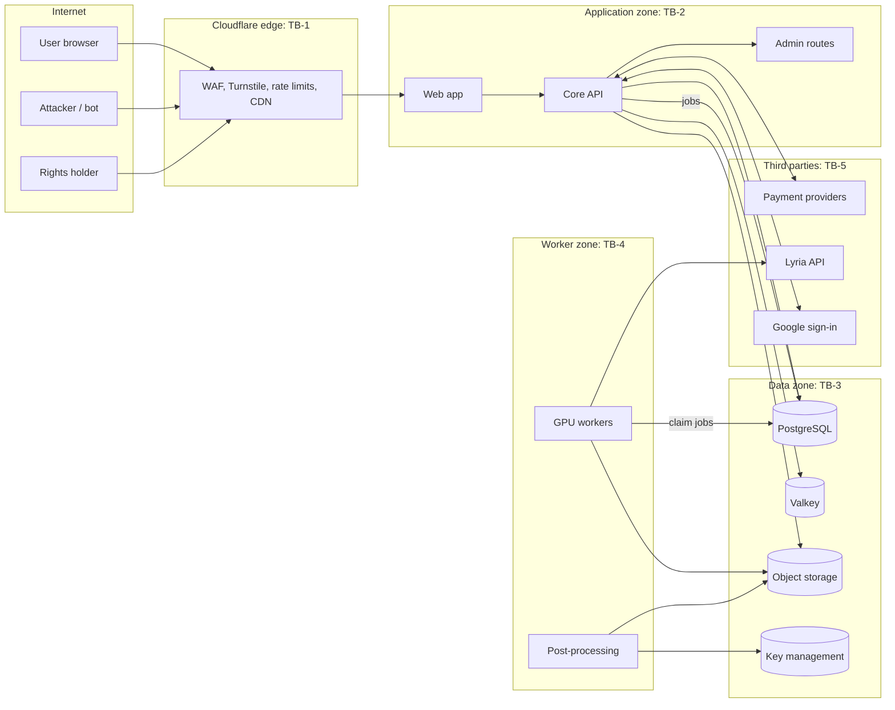

# Security architecture and threat model

| Item | Value |
| --- | --- |
| Version | 0.1 (Batch 2) |
| Date | 2026-10-28 |
| Perspective | Security architect and penetration tester |
| Scope | MVP as defined in [PRD v2.1](../02-product/prd.md) and [TDD v2.0](../03-architecture/tdd.md) |
| Method | Data-flow diagram, STRIDE per element, AI-specific abuse cases, controls mapped to requirements |
| Status | Draft. Nothing is built yet (DEC-001), so every control is a requirement, not a verified control. |

## 1. Assets

| ID | Asset | Why it matters |
| --- | --- | --- |
| AS-01 | User accounts and sessions | Takeover exposes songs, payments, identity |
| AS-02 | Unreleased songs, stems and lyrics | Creative and commercial value; leaks harm users |
| AS-03 | Rights records: certificates, ownership state, provenance ledger | Legal evidence; forgery undermines the business |
| AS-04 | Signing keys (C2PA, ledger digest) and watermark keys | Compromise invalidates every credential |
| AS-05 | Personal data (email, phone, date of birth, country, consent records) | DPDP and GDPR duties (COMP-IN-04, COMP-EU-02) |
| AS-06 | Payment state (subscriptions, credits) | Fraud and revenue loss; no card data is stored (ADR-009) |
| AS-07 | GPU capacity and API fallback budget | Abuse burns money (RISK-004, RISK-008) |
| AS-08 | Model weights and configuration | Tampering changes output or inserts malicious code |
| AS-09 | Admin console | Highest privilege |
| AS-10 | Brand and platform trust | Spam, impersonation and infringement on public pages damage the brand |

## 2. Trust boundaries and data flow

Boundaries: TB-1 internet to edge; TB-2 edge to application; TB-3 application to data; TB-4 queue to workers (workers have no inbound internet); TB-5 calls to and from third parties.

## 3. STRIDE analysis

Likelihood and impact use High, Medium and Low. Each threat maps to a security requirement in section 5.

| ID | Element | STRIDE | Threat | L | I | Mitigation | Requirement |
| --- | --- | --- | --- | --- | --- | --- | --- |
| TM-01 | Sign-in | Spoofing | Credential stuffing or OTP brute force | High | High | Rate limits per IP, account and device; OTP expiry 10 min, 5 attempts; Turnstile | REQ-SEC-01 |
| TM-02 | Sessions | Spoofing | Session theft through XSS or token leakage | Medium | High | HttpOnly, Secure, SameSite cookies; short sessions with rotation; strict CSP | REQ-SEC-01, REQ-SEC-05 |
| TM-03 | Song, take, asset APIs | Info disclosure | Insecure direct object reference (BUG-067) | High | High | Owner check on every read and write; random 128-bit IDs; automated authorisation tests per endpoint | REQ-SEC-02 |
| TM-04 | Downloads and share links | Info disclosure | Leaked links expose unreleased music forever | Medium | Medium | Signed URLs valid 15 min; revocable share tokens; download audit | REQ-SEC-03 |
| TM-05 | Prompt and lyric input | Tampering | Unicode tricks (homoglyphs, zero-width) bypass artist-name and moderation filters | High | Medium | NFC normalise; strip zero-width; confusable folding; transliteration-aware matching | REQ-SEC-04 |
| TM-06 | Lyric model | Tampering | Prompt injection makes the lyric model ignore safety rules or leak its system prompt | High | Medium | Input delimiting; output moderation; no secrets in prompts; model has no tools | REQ-SEC-04 |
| TM-07 | Public pages, embeds | Tampering | Stored XSS through titles or lyrics | Medium | High | Output encoding; CSP; sanitise rich text; no raw HTML | REQ-SEC-05 |
| TM-08 | Provenance ledger | Repudiation and tampering | Insider or attacker rewrites events | Low | High | Hash chain; append-only role; hourly signed digest; digest published | REQ-SEC-07 |
| TM-09 | Signing keys | Info disclosure | Key theft lets attacker forge certificates | Low | High | Keys in managed KMS, never exported; signing service with its own identity; rotation and revocation list | REQ-SEC-07 |
| TM-10 | Admin console | Elevation | Admin account takeover or missing role checks | Medium | High | Mandatory MFA (passkey or TOTP); separate role; admin actions logged to ledger; IP allow list optional | REQ-SEC-06 |
| TM-11 | Generation API | Denial of service | Bots exhaust GPU capacity or API fallback budget | High | High | Turnstile; daily caps; concurrency limits; fallback spend cap; queue priorities | REQ-SEC-09 |
| TM-12 | Free plan | Spoofing | Account farming for free generations and commercial licences | High | Medium | Device fingerprint; phone verification before free commercial licences; velocity rules | REQ-SEC-09 |
| TM-13 | Payments | Tampering | Forged webhook grants a paid plan | Medium | High | Verify provider signatures; idempotency keys; reconcile against provider API | REQ-SEC-08 |
| TM-14 | Payments | Repudiation | Chargeback after bulk download | Medium | Medium | Rights vest after settlement; reversal handling (REQ-F-57) | REQ-F-57 |
| TM-15 | Verify page | Info disclosure and DoS | Used as an oracle to test watermark removal, or flooded with large files (BUG-052) | High | Medium | Rate limit; Turnstile; 20 MB cap; coarse answers for anonymous users | REQ-SEC-10 |
| TM-16 | Workers | Tampering | Malicious or tampered model weights execute code on load | Low | High | Load weights only in safetensors format from pinned hashes; no pickle loading; workers have no inbound network | REQ-SEC-11 |
| TM-17 | Supply chain | Tampering | Compromised dependency or container image | Medium | High | Lock files; Renovate; dependency and image scanning; signed images; minimal base images | REQ-SEC-12 |
| TM-18 | Repository | Info disclosure | Secrets committed to the public repository | Medium | High | Secret scanning in CI and pre-commit; `.gitignore`; secrets only in a vault | REQ-SEC-12 |
| TM-19 | Object storage | Info disclosure | Bucket made public by mistake | Low | High | Private buckets only; access only through signed URLs; infrastructure-as-code policy checks | REQ-SEC-03 |
| TM-20 | Database | Info disclosure | Backup leaked | Low | High | Encrypted backups; separate credentials; restore tests | REQ-SEC-13 |
| TM-21 | Logs | Info disclosure | Personal data or tokens written to logs | Medium | Medium | Structured logging with redaction; 30-day retention | REQ-SEC-13 |
| TM-22 | Takedown process | Spoofing | False takedown notices used to harass creators | Medium | Medium | Notice validation; counter-notice; appeal queue (REQ-F-59) | REQ-F-54, REQ-F-59 |

## 4. AI and music-specific abuse cases

| ID | Abuse case | Impact | Control |
| --- | --- | --- | --- |
| AB-01 | Prompt asks for a famous artist's voice or style, or a specific song | Infringement, personality-rights claims | Artist and title block list in all launch scripts; refusal message; logging (REQ-F-50) |
| AB-02 | Generated output closely resembles a known recording | Infringement claim against user and BeatMind (RISK-001) | Similarity screen before delivery; withheld takes refunded; takedown path |
| AB-03 | Lyric model outputs known copyrighted lyrics | Infringement | Refuse requests naming titles; lyric similarity check where a lawful index exists (BUG-023) |
| AB-04 | Hate, communal or caste slurs, threats, sexual content involving minors in lyrics | Legal exposure, platform bans | Multilingual moderation (Hindi Devanagari, romanised Hindi, English); human review queue (BUG-065, BUG-083) |
| AB-05 | Bulk generation to flood streaming services | Platform bans, reputational harm | Caps; attribution on free songs; release pipeline gate in Phase 2 |
| AB-06 | User strips watermark and claims a BeatMind song as human-made | Mislabelling, regulatory exposure | Ledger and C2PA as independent evidence; terms forbid removal (India IT Rules require markers not be removed, SRC-117) |
| AB-07 | User mixes a BeatMind stem into a copyrighted song to dispute a claim with a BeatMind certificate | Fraud | Certificate bound to full-file hash; verify page reports partial match (BUG-049) |
| AB-08 | Political deepfake song impersonating a public figure before an election | Legal and reputational harm | Public-figure name block; election-period policy; rapid takedown |

## 5. Security requirements

| ID | Requirement | Verification |
| --- | --- | --- |
| REQ-SEC-01 | Authentication meets OWASP ASVS 5.0 level 2 chapters on authentication and session management; OTP and login rate limits per IP, account and device | ASVS checklist; automated tests TC-REQ-SEC-01-* |
| REQ-SEC-02 | Every API endpoint enforces object-level authorisation; resource IDs are random 128-bit values | Generated authorisation test per endpoint (TC-REQ-SEC-02-*) |
| REQ-SEC-03 | Object storage is private; downloads use signed URLs valid at most 15 minutes; share tokens are revocable | Integration tests; infrastructure policy check |
| REQ-SEC-04 | All text input is NFC-normalised, stripped of zero-width characters and folded for confusables before moderation and block-list checks; lyric-model prompts delimit user input and outputs are moderated | Unit tests with a Unicode attack corpus |
| REQ-SEC-05 | Content Security Policy without `unsafe-inline` scripts; all user text output-encoded; no user HTML | DAST scan; unit tests |
| REQ-SEC-06 | MFA mandatory for admin and support roles; optional passkey or TOTP for users | Tests; access review |
| REQ-SEC-07 | Signing keys held in a managed KMS and never exported; ledger digest signed and published hourly; documented key rotation and revocation | Key ceremony record; tests |
| REQ-SEC-08 | Payment webhooks verified by signature and idempotency key; plan state reconciled daily with provider | Contract tests with provider sandboxes |
| REQ-SEC-09 | Bot defence (Turnstile), per-plan caps, concurrency limits, device and payment velocity rules, and a hard daily spend cap on the API fallback | Load and abuse tests |
| REQ-SEC-10 | Verify endpoint and public pages have separate rate limits, a 20 MB upload cap, CDN caching and are shed before generation under load | Load tests |
| REQ-SEC-11 | Model weights loaded only in safetensors format from SHA-256-pinned files; GPU workers have no inbound network and outbound only to storage, queue and allowed APIs | Startup check; network policy test |
| REQ-SEC-12 | CI runs dependency scanning, container image scanning, secret scanning and static analysis on every pull request; high and critical findings block merge | CI configuration |
| REQ-SEC-13 | Encryption at rest for database, backups and storage; logs redact personal data and tokens; 30-day log retention | Configuration review; log tests |
| REQ-SEC-14 | Security headers (HSTS, X-Content-Type-Options, Referrer-Policy, Permissions-Policy) on all responses | Automated header test |
| REQ-SEC-15 | Incident response: severity levels, 24-hour on-call contact in beta, breach assessment within 24 hours, notifications as the compliance register requires | Tabletop exercise before beta |

## 6. Security testing plan

| Activity | When | Tool (free or open source) |
| --- | --- | --- |
| Static analysis | Every pull request | Semgrep community rules, SpotBugs with Find Security Bugs (Java), Bandit (Python), ESLint security plugin |
| Dependency and image scanning | Every pull request and nightly | OWASP Dependency-Check or Trivy; GitHub Dependabot alerts |
| Secret scanning | Pre-commit and every pull request | Gitleaks; GitHub secret scanning (public repository) |
| Dynamic scanning | Nightly against staging | OWASP ZAP baseline |
| Authorisation tests | Every pull request | Generated JUnit tests per endpoint (TC-REQ-SEC-02-*) |
| Abuse and load tests | Before beta and each release | k6 |
| Manual penetration test | Before public launch (gate G3) | Independent tester; scope from this document |
| Unicode attack corpus | Every pull request touching moderation | Custom test set in `test-data/unicode-attacks` |

## 7. Residual risks accepted for the beta

| Risk | Why accepted | Revisit |
| --- | --- | --- |
| Watermark can be removed by a determined attacker | No watermark is robust to all attacks; the ledger and C2PA remain | After robustness tests (TD-04) |
| Similarity screening coverage is partial | No lawful global reference index is affordable before funding (TD-03) | After funding |
| Single-region hosting | Cost | Post-funding SRE plan |
